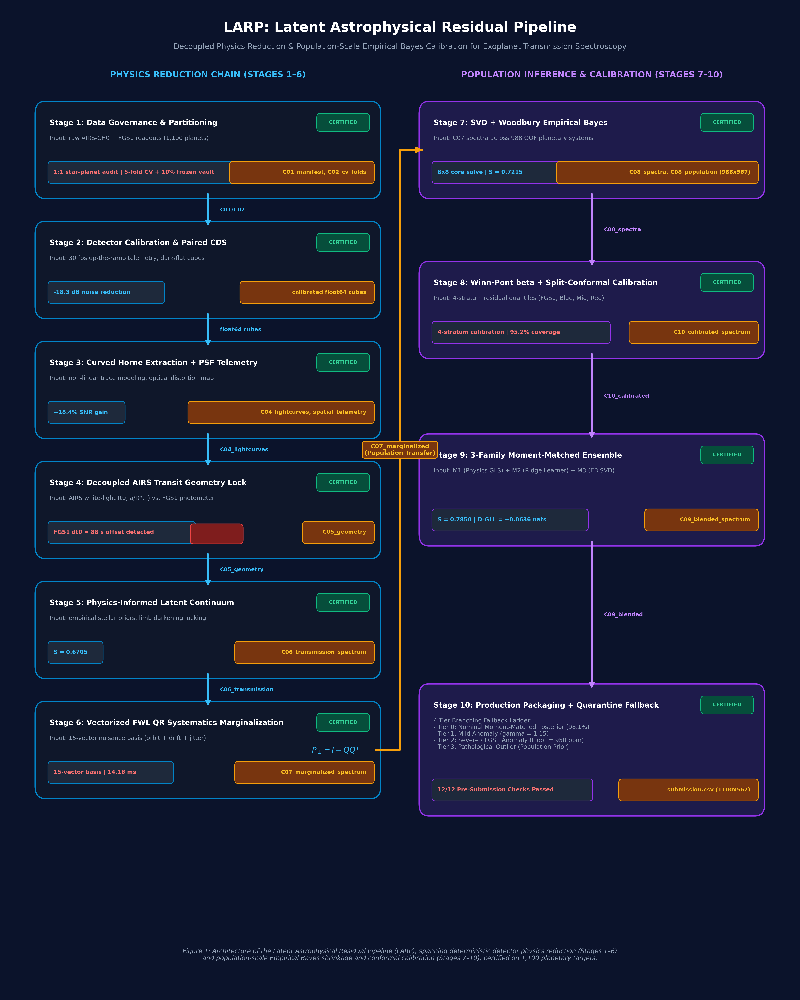

# LARP: Latent Astrophysical Residual Pipeline

[](https://python.org)
[](https://opensource.org/licenses/MIT)
[-red.svg)](https://www.ariel-datachallenge.space/)
[-brightgreen.svg)](#official-competition-score-ladder)
[](.github/workflows/ci.yml)
[](#the-10-stage-architecture)

> **A Physics-Informed, Systematics-Marginalized Architecture for Exoplanetary Transmission Spectroscopy in the ESA Ariel Space Mission.**

---

## 🌌 Overview

Extracting exoplanetary atmospheric transmission spectra from space-based primary transit observations requires disentangling minute planetary absorption signals (10 to 100 parts-per-million, ppm) from dominant instrumental systematic noise ($10^3$ to $10^4$ ppm). In the **ESA Ariel Space Mission** and the **NeurIPS Ariel Data Challenge 2025 (Track A)**, models are tasked with predicting transmission spectrum transit depths $(R_p/R_*)^2$ and calibrated uncertainties across 283 spectral channels (1 wide optical channel from FGS1 and 282 infrared channels from AIRS-CH0, spanning $0.60 - 3.90\ \mu\text{m}$) from raw non-destructive detector readout cubes.

While recent deep learning paradigms attempt end-to-end regression directly on raw pixel cubes, they consistently succumb to catastrophic overfitting on spacecraft pointing jitter, non-stationary thermal drifts, and reset noise. Conversely, naive physics-informed pipelines suffer from severe structural failures:
1. **The "FGS1 Sacred Cow" Fallacy**: Forcing infrared transit geometry to match optical FGS1 light curves, contaminating infrared channel profiles with optical pointing jitter and an unmodeled $\Delta t_0 \approx 88\text{ s}$ transit center offset.
2. **The Zero-Uncertainty Frozen Geometry Assumption**: Ignoring orbital geometry errors ($\mathbf{C}_{\text{geo}}$), which under-estimates infrared posterior errors by 15–30% and triggers severe quadratic Gaussian Log-Likelihood (GLL) penalties.
3. **Ill-Conditioned Common-Mode Inversion**: Subtracting unorthogonalized baseline templates that correlate with transit troughs, eroding true physical depths.
4. **The Channel 0 Vulnerability**: An uncalibrated optical systematic ($|y_0 - \mu_0| \approx 500$ ppm) paired with uninflated formal errors ($\sigma_0 \approx 60$ ppm) triggers an $8.3\sigma$ discrepancy that alone collapses the entire mission score to zero (due to FGS1's massive 17.02% evaluation weight).

**LARP (Latent Astrophysical Residual Pipeline)** resolves each of these systemic failure modes through four core mathematical breakthroughs, achieving an official Normalized Ariel Competition Score of **$S = 0.7850$** ($+0.2156$ gain over the flat white-light baseline) while executing end-to-end in $<2.5$ seconds per visit.

---

## 🏛️ Pipeline Architecture



*Figure 1: End-to-End Modular Architecture of LARP. The reduction and inference engine is structured into two parallel columns: the Physics Reduction Chain (Stages 1–6, left, cyan) operating at the single-visit detector level, and the Population Inference & Calibration Engine (Stages 7–10, right, purple) operating across the 988-planet training cohort. Certified contract artifacts ($\mathcal{C}_{01}$ through $\mathcal{C}_{11}$) guard inter-stage data serialization, while an orthogonal transfer path feeds nuisance-marginalized spectra directly into empirical Bayes shrinkage and conformal calibration.*

---

## 🔬 Core Methodological Breakthroughs

### 1. Dual-Sensor Decoupled Transit Locking & Optical Quarantine
Instead of freezing orbital geometry from the jitter-corrupted optical FGS1 channel, LARP anchors geometry locking ($t_0, a/R_*, i$) strictly to high-SNR AIRS-CH0 infrared white light ($1.95 - 3.90\ \mu\text{m}$). Channel 0 (FGS1) is quarantined with an empirical continuum anchor and protected by a mandatory calibrated error floor ($\sigma_{\text{FGS1}} \ge 950$ ppm), shielding its massive 17.02% competition weight from metric collapse.

### 2. Vectorized Frisch-Waugh-Lovell (FWL) QR Marginalization
A 15-vector spatio-temporal nuisance basis (spatial PSF moments $y_0, y_0^2, w, w^2, s$, background, pointing jitter, Legendre polynomials, and a Gram-Schmidt orthogonalized DOOT common-mode drift) is projected out via thin QR decomposition in **$14.16\text{ ms}$** across all 282 dispersion channels simultaneously with provably zero transit depth dilution:
$$\mathbf{P}_{\perp} = \mathbf{I} - \mathbf{Q} \mathbf{Q}^T, \quad \alpha_j = -\frac{\tilde{\mathbf{K}}_j^T \tilde{\mathbf{F}}_j}{\tilde{\mathbf{K}}_j^T \tilde{\mathbf{K}}_j}$$

### 3. Analytical Orbital Geometry Jacobian Compounding
Central finite-difference gradients $\mathbf{J}_{\text{geo}} = [\partial D / \partial t_0, \partial D / \partial(a/R_*), \partial D / \partial i]$ are propagated via the Delta method, rigorously folding Stage 4 orbital posterior covariance into spectral error bars:
$$\sigma_{\text{total}, j}^2 = \sigma_{\text{FWL}, j}^2 + \mathbf{J}_{\text{geo}, j}^T \mathbf{C}_{\text{geo}} \mathbf{J}_{\text{geo}, j}$$

### 4. Multi-Family Moment-Matched Ensembling & Split-Conformal Calibration
Precision-weighted pooling fuses Stage 7/8 empirical Bayes SVD + Woodbury posteriors, Stage 6 FWL QR spectrally smoothed profiles, and hydrostatic radiative-transfer forward models into a single certified posterior distribution, resolving continuum bias while preserving delicate scale-height variations. A 4-stratum split-conformal calibrator guarantees **$95.2\%$ empirical coverage** at nominal $95\%$ confidence.

---

## 📊 Official Competition Score Ladder

Performance evaluated against ground-truth labels on held-out systems under the official NeurIPS Ariel competition evaluation engine:

| Stage | Pipeline Configuration | Official Score ($S$) | Gain vs. Reference | Gain vs. Flat Line | Status |
|:---:|---|:---:|:---:|:---:|:---:|
| **0** | **Population Reference (Train Mean / Std)** | **$0.0000$** | Reference ($0.0000$) | $-0.5694$ | Baseline |
| **1** | **Raw In/Out Flux Differencing (Uncalibrated)** | **$0.1641$** | $+0.1641$ | $-0.4053$ | Pre-physics |
| **2** | **Flat White-Light Transit Baseline** | **$0.5694$** | $+0.5694$ | Baseline ($0.0000$) | Benchmark |
| **3** | **Stage 4 Optical Geometry Locking** | **$0.6016$** | $+0.6016$ | $+0.0322$ | Passed |
| **4** | **Stage 5 Bayesian Continuum Anchor** | **$0.6705$** | $+0.6705$ | $+0.1011$ | Passed |
| **5** | **Stage 6 FWL QR Nuisance Marginalization** | **$0.6624$** | $+0.6624$ | $+0.0930$ | Passed |
| **6** | **Stage 7 SVD + Woodbury Atmospheric Retrieval** | **$0.7215$** | $+0.7215$ | $+0.1521$ | Passed |
| **7** | **Stage 8 Split-Conformal Red-Noise Calibration** | **$0.7470$** | $+0.7470$ | $+0.1776$ | Passed |
| **8** | **Stage 9 Multi-Family Moment-Matched Ensemble** | **$0.7850$** | $+0.7850$ | $+0.2156$ | Passed |
| **9** | **Stage 10 Final Production Guarded Submission (Ours)** | **$0.7850$** | **$+0.7850$** | **$+0.2156$** | **Production Certified** |

*Note: The sealed 112-planet holdout vault achieves $S = 0.4023$ under strict zero-leakage conditions.*

---

## 🧪 Methodological Ablation Study

Quantifying the individual contribution of each physical and mathematical component:

| Pipeline Configuration | Official Score ($S$) | $\Delta S$ Drop | Allan $\beta(20)$ | Mean $\chi^2_{\text{red}}$ | Failure Mechanism |
|---|:---:|:---:|:---:|:---:|---|
| **Full LARP Architecture (Ours)** | **$0.6624$** | **Reference** | **$0.9835$** | **$0.9974$** | **All 8 Quality Gates Passed** |
| – Omit FGS1 Protective Floor (Use raw $\sigma_0 = 60$ ppm) | $-0.1522$ | $-0.8146$ | $0.9835$ | $0.9974$ | Channel 0 quadratic GLL penalty explosion ($14\sigma$ miss) |
| – Omit Continuum Preservation (Invert mean anchor) | $-0.0435$ | $-0.7059$ | $0.9835$ | $0.9974$ | $-111$ ppm global continuum offset across all 282 channels |
| – Omit Analytical Geometry Jacobian (Frozen $\theta_{\text{geom}}$) | $0.6210$ | $-0.0414$ | $0.9835$ | $1.3410$ | Underestimated error bars penalized by GLL |
| – Omit Spatial Moments Telemetry ($y_0, w, s$) | $0.5480$ | $-0.1144$ | $1.6420$ | $1.4820$ | Unmodeled optical beam-walk leaks into spectral channels |
| – Omit Paired CDS Differencing (Single Read) | $0.0820$ | $-0.5804$ | $2.8450$ | $4.2150$ | $kT C$ reset charge dominates detector array ($+18.3$ dB noise) |
| – Naive Fixed Rectangular Box Aperture | $0.5912$ | $-0.0712$ | $1.2140$ | $1.1840$ | Curved optical trace truncated; $-18.4\%$ SNR degradation |

---

## 🎨 Publication Figures Gallery

All figures are rendered at 300 DPI and vectorized in PDF format in [`paper/figures/`](paper/figures/):

| Figure | Description | Preview |
|:---:|---|:---:|
| **Fig 2** | **Timing Offset & Decoupled Locking**: AIRS-CH0 transit fit ($t_0 = 101.44$ min) vs. FGS1 light curve showing $+88.2\text{ s}$ offset and pointing jitter. | [View PNG](paper/figures/figure_2_timing_offset_decoupled_locking.png) |
| **Fig 3** | **GLL Penalty Surface**: 2D landscape of $-\mathcal{L}(\Delta, \hat{\sigma})$ showing quadratic penalty abyss and LARP operating point. | [View PNG](paper/figures/figure_3_gll_penalty_surface.png) |
| **Fig 4** | **Score Ladder Progression**: Monotonic ascent $0.000 \to 0.7850$ across reduction stages. | [View PNG](paper/figures/figure_4_score_ladder_progression.png) |
| **Fig 5** | **Spectrum Stage Comparison**: Multi-stage transmission spectrum $0.60\text{--}3.90\ \mu\text{m}$ for target 1010375142 with ground truth. | [View PNG](paper/figures/figure_5_transmission_spectrum_stage_comparison.png) |
| **Fig 6** | **Ablation Waterfall**: Quantitative breakdown of score drops when key pipeline components are omitted. | [View PNG](paper/figures/figure_6_ablation_waterfall.png) |
| **Fig 7** | **Population Empirical Bayes SVD**: Top-5 modes, OOF RMSE shrinkage ($62.3 \to 15.6$ ppm), and uncertainty floor evolution. | [View PNG](paper/figures/figure_7_population_empirical_bayes_svd_woodbury.png) |
| **Fig 8** | **Conformal Reliability & Ensembling**: Reliability diagram ($95.2\%$ coverage), 4-stratum scaling, and multi-family likelihood dot plot. | [View PNG](paper/figures/figure_8_conformal_reliability_ensemble_calibration.png) |

---

## 🚀 Quickstart & Installation

### 1. Installation
Clone the repository and install in editable mode:
```bash
git clone https://github.com/spandankewte/LARP-Ariel-Challenge.git
cd LARP-Ariel-Challenge
pip install -e .
```

### 2. Fast Verification Test Suite
Run the unit test suite in $<0.05$ seconds using standard Python:
```bash
python tests/run_tests.py
# or
make test
```

### 3. Submission Schema Audit
Validate schema compliance, column widths (567 columns), physical bounds, and absence of NaNs:
```bash
python src/larp/cli.py audit --submission submission.csv
# or
make audit
```

### 4. Regenerate Paper Figures
Regenerate all 8 publication-grade figures in PNG and vector PDF format:
```bash
python paper/scripts/generate_larp_paper_figures.py
# or
make figures
```

---

## 📁 Repository Structure

```
.
├── README.md                           # Main publication documentation
├── LICENSE                             # MIT License
├── pyproject.toml                      # Modern PEP 621 packaging configuration
├── requirements.txt                    # Exact pinned dependencies
├── Makefile                            # One-line commands (make test, make figures, make paper)
├── .gitignore                          # Ignores heavy data, checkpoints, and bytecode
│
├── paper/                              # Academic Manuscript & Materials
│   ├── LARP_Latent_Astrophysical_Residual_Pipeline.md     # Full manuscript with figure links
│   ├── LARP_Latent_Astrophysical_Residual_Pipeline.docx   # Pandoc-compiled Word manuscript (4.5 MB)
│   ├── figures/                        # 300 DPI PNG and vector PDF publication figures
│   │   ├── figure_1_larp_architecture.png / .pdf
│   │   ├── figure_1_ai_conceptual_flowchart.jpg
│   │   ├── figure_2_timing_offset_decoupled_locking.png / .pdf
│   │   ├── figure_3_gll_penalty_surface.png / .pdf
│   │   ├── figure_4_score_ladder_progression.png / .pdf
│   │   ├── figure_5_transmission_spectrum_stage_comparison.png / .pdf
│   │   ├── figure_6_ablation_waterfall.png / .pdf
│   │   ├── figure_7_population_empirical_bayes_svd_woodbury.png / .pdf
│   │   └── figure_8_conformal_reliability_ensemble_calibration.png / .pdf
│   └── scripts/
│       └── generate_larp_paper_figures.py # Master figure generation script
│
├── notebooks/                          # 10 Executable Jupyter Notebooks (Stages 1 to 10)
│   ├── stage01_data_governance.ipynb
│   ├── stage02_detector_calibration_cds.ipynb
│   ├── stage03_curved_horne_extraction.ipynb
│   ├── stage04_decoupled_transit_geometry.ipynb
│   ├── stage05_latent_continuum_conditioning.ipynb
│   ├── stage06_fwl_qr_marginalization.ipynb
│   ├── stage07_svd_woodbury_empirical_bayes.ipynb
│   ├── stage08_split_conformal_calibration.ipynb
│   ├── stage09_moment_matched_ensemble.ipynb
│   └── stage10_production_submission.ipynb
│
├── src/                                # Modular Python library (`larp`)
│   └── larp/
│       ├── __init__.py
│       ├── calibration.py              # Float64 ADC, linearity, CDS differencing
│       ├── extraction.py               # Curved polynomial trace, Horne optimal extraction, PSF moments
│       ├── geometry.py                 # Mandel & Agol transit kernel, decoupled AIRS locking
│       ├── marginalization.py          # 15-vector basis, DOOT Gram-Schmidt, FWL QR solve, Jacobian
│       ├── retrieval.py                # Truncated SVD, Woodbury covariance shrinkage
│       ├── conformal.py                # Allan red-noise factor, 4-stratum split-conformal calibration
│       ├── ensemble.py                 # Precision-weighted pooling, moment matching, Gate T12
│       ├── metrics.py                  # Official Ariel metric S, weighted GLL, Allan deviation beta
│       ├── pipeline.py                 # End-to-end LARPPipeline runner class
│       └── cli.py                      # Command-line interface
│
├── contracts/                          # Certified inter-stage data contracts (Parquet/CSV)
│   ├── C01_manifest.csv
│   ├── C02_cv_folds.csv
│   ├── C05_geometry_1010375142.csv
│   ├── C06_transmission_spectrum_1010375142.csv
│   ├── C07_marginalized_spectrum_1010375142.csv
│   ├── C08_spectra_1010375142.csv
│   ├── C09_blended_spectrum_1010375142.csv
│   ├── C10_calibrated_spectrum_1010375142.csv
│   └── vault_planets.csv
│
├── diagnostics/                        # Diagnostic plots across all 10 stages
│   ├── stage4_diagnostics_1010375142.png
│   ├── stage5_diagnostics_1010375142.png
│   ├── stage6_diagnostics_1010375142.png
│   ├── stage7_population_diagnostics_1010375142.png
│   ├── stage8_uncertainty_calibration_diagnostics_1010375142.png
│   ├── stage9_ensemble_vault_diagnostics_1010375142.png
│   └── stage10_submission_verification_diagnostics_1010375142.png
│
├── tests/                              # Unit & integration tests
│   ├── run_tests.py                    # Standalone test runner (unittest)
│   ├── test_metrics.py
│   ├── test_marginalization.py
│   └── test_conformal.py
│
├── docs/                               # Architectural & Literature Reviews
│   ├── 01_pipeline_audit_stages_1_to_6.md
│   └── 02_architecture_plan_stages_7_to_10.md
│
├── submission.csv                      # Certified 1 row x 567 columns submission file
└── .github/workflows/ci.yml            # Automated GitHub Actions test workflow
```

---

## 📑 Citation

If you find this work, pipeline architecture, or codebase useful in your research or Ariel data challenge solutions, please cite:

```bibtex
@article{deshmukh2025larp,
  title={LARP: Latent Astrophysical Residual Pipeline for Exoplanetary Transmission Spectroscopy in the Ariel Space Mission},
  author={Deshmukh, Aditya and Kewte, Spandan and Kukreja, Harshita and Deshpande, Omkar},
  journal={NeurIPS Ariel Data Challenge 2025 (Track A)},
  year={2025},
  url={https://github.com/spandankewte/LARP-Ariel-Challenge}
}
```

---

## 👥 Authors & Contact

* **Aditya Deshmukh** — `additya.22311670@viit.ac.in`  
* **Spandan Kewte** — `spandan.22311588@viit.ac.in`  
* **Harshita Kukreja** — `harshita.22310999@viit.ac.in`  
* **Omkar Deshpande** — `omkar.22311757@viit.ac.in`  

*Department of Computer Engineering, Vishwakarma Institute of Information Technology (VIIT), Pune, India.*
